

  <a href="https://maqhawe-portfolio.vercel.app/">
    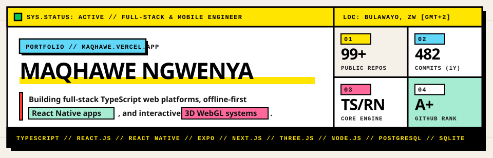
  </a>

  <a href="https://maqhawe-portfolio.vercel.app/">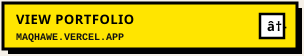</a>
  
  <a href="https://github.com/Thabisomaqhawengwenya">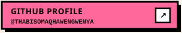</a>

## About

I am **Maqhawe Thabiso Ngwenya**, a **Front-end Developer** based in Zimbabwe. I focus on designing and building responsive web interfaces, interactive front-end components, and practical applications using **React, JavaScript, TypeScript, HTML, and CSS**.

Alongside front-end development and UI/UX design, I regularly work with **Node.js, Express, PostgreSQL, SQLite, Firebase, and React Native (Expo)** to connect interfaces to real data and build complete web and mobile tools.

---

  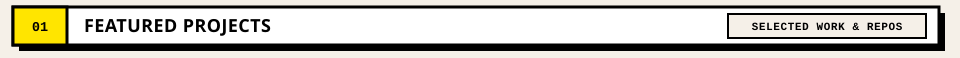

  <a href="https://maqhawe-portfolio.vercel.app/">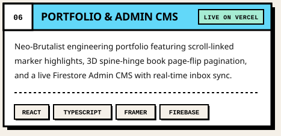</a>
  <a href="https://elohims-legacy.vercel.app">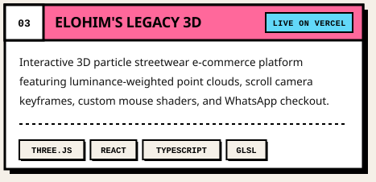</a>

  <a href="https://arcane-murex-five.vercel.app">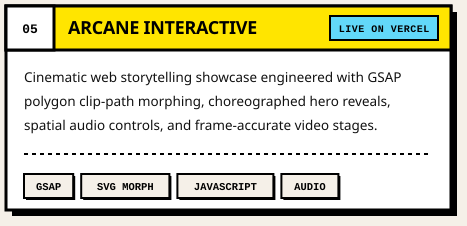</a>
  <a href="https://github.com/Thabisomaqhawengwenya/cashflow-mate">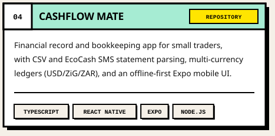</a>

  <a href="https://school-management-khaki-two.vercel.app">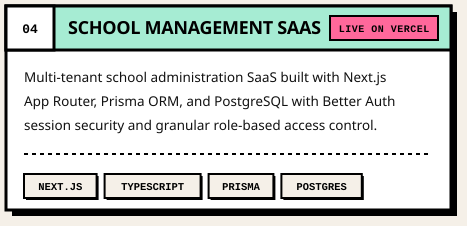</a>
  <a href="https://github.com/Thabisomaqhawengwenya/lifeos">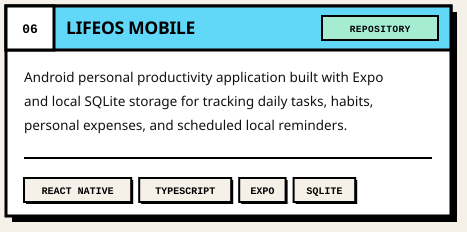</a>

<table>
  <thead>
    <tr>
      <th align="left">Project</th>
      <th align="left">Focus &amp; Stack</th>
      <th align="left">Links</th>
    </tr>
  </thead>
  <tbody>
    <tr>
      <td><b>01. Developer Portfolio</b></td>
      <td>Neo-brutalist personal portfolio with 3D book pagination, scroll highlights, and Firebase CMS (<code>React</code>, <code>TypeScript</code>, <code>Styled Components</code>, <code>Vite</code>)</td>
      <td><a href="https://maqhawe-portfolio.vercel.app/">Live Site</a> · <a href="https://github.com/Thabisomaqhawengwenya/portfolio">Source</a></td>
    </tr>
    <tr>
      <td><b>02. Elohim's Legacy</b></td>
      <td>Interactive 3D particle storefront experiment with scroll camera keyframes and WhatsApp checkout (<code>React</code>, <code>Three.js</code>, <code>TypeScript</code>)</td>
      <td><a href="https://elohims-legacy.vercel.app">Live Demo</a> · <a href="https://github.com/Thabisomaqhawengwenya/elohims-legacy">Source</a></td>
    </tr>
    <tr>
      <td><b>03. Arcane Interactive</b></td>
      <td>Front-end motion and visual storytelling study using clip-path morphing and timed video transitions (<code>HTML5</code>, <code>CSS3</code>, <code>JavaScript</code>, <code>GSAP</code>)</td>
      <td><a href="https://arcane-murex-five.vercel.app">Live Demo</a> · <a href="https://github.com/Thabisomaqhawengwenya/arcane">Source</a></td>
    </tr>
    <tr>
      <td><b>04. CashFlow Mate</b></td>
      <td>Bookkeeping and cash-flow web and mobile application with CSV/EcoCash statement import (<code>TypeScript</code>, <code>React Native</code>, <code>Expo</code>, <code>Node.js</code>)</td>
      <td><a href="https://github.com/Thabisomaqhawengwenya/cashflow-mate">Repository</a></td>
    </tr>
    <tr>
      <td><b>05. School Management App</b></td>
      <td>Role-based school administration web app with student records and dashboards (<code>Next.js</code>, <code>TypeScript</code>, <code>Prisma</code>, <code>PostgreSQL</code>)</td>
      <td><a href="https://school-management-khaki-two.vercel.app">Live Demo</a> · <a href="https://github.com/Thabisomaqhawengwenya/school_management">Source</a></td>
    </tr>
    <tr>
      <td><b>06. LifeOS Mobile</b></td>
      <td>Offline-first Android personal task, habit, and expense tracker with local persistence (<code>React Native</code>, <code>TypeScript</code>, <code>Expo</code>, <code>SQLite</code>)</td>
      <td><a href="https://github.com/Thabisomaqhawengwenya/lifeos">Repository</a></td>
    </tr>
  </tbody>
</table>

---

  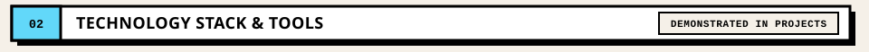

  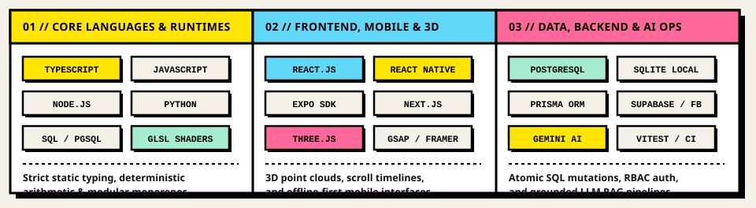

---

  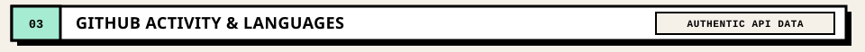

  <a href="https://github.com/Thabisomaqhawengwenya">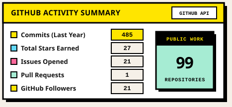</a>
  <a href="https://github.com/Thabisomaqhawengwenya?tab=repositories">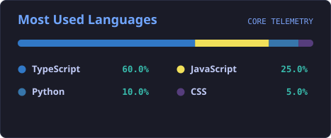</a>

---

  <a href="https://maqhawe-portfolio.vercel.app/">
    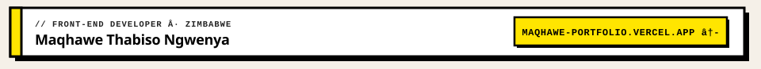
  </a>

